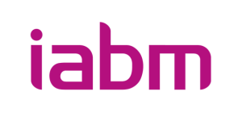

# Dynamic Software Licensing Best Practices

## Purpose

This repository contains the reviewed draft of an IABM industry best practices document for software-based, dynamic software licensing in broadcast and media workflows.

The best-practices document is not a formal standard. It is deliberately structured in a standard-like way to support alignment across manufacturers, operators, system integrators, and industry stakeholders.

## Scope of This Repository

This repository is used to:
- define and evolve the structure of the best-practices document,
- capture terminology and architectural concepts,
- document normative and informative content separately,
- support collaborative drafting and review in a transparent, versioned way.

This repository does **not** yet represent a final published best-practices document.

## Document Structure

| Area | Purpose |
| --- | --- |
| `best-practices/` | Core best practices chapters |
| `annexes/normative/` | Normative annexes required for consistent interpretation |
| `annexes/informative/` | Examples, mappings, FAQs, reference architectures |
| `schemas/` | Machine-readable data schemas |
| `diagrams/` | Architecture and sequence diagrams |

## How to Navigate

- [best-practices/index.md](best-practices/index.md) — chapter list and status overview
- [best-practices/04-terminology-and-abbreviations/](best-practices/04-terminology-and-abbreviations/) — controlled vocabulary
- [best-practices/09-normative-requirements/](best-practices/09-normative-requirements/) — normative requirements structure

## Working Principles

- Terminology first.
- Structure before detail.
- Platform-agnostic main document.
- Clear separation of normative and informative content.
- Versioned development through Git and GitHub.

## Team Workflow

- [WORKFLOW.md](WORKFLOW.md) — team operating model: milestones, issues, roles, delivery
- [CONTRIBUTING.md](CONTRIBUTING.md) — branch, PR, git commands, writing rules
- [GOVERNANCE.md](GOVERNANCE.md) — roles, status definitions, editorial rules

## Current Status

Repository status: **Reviewed Draft**

The main document is now organized as a complete review draft for group comment ahead of the planned end-of-August release. See [best-practices/index.md](best-practices/index.md) for chapter-level status.
