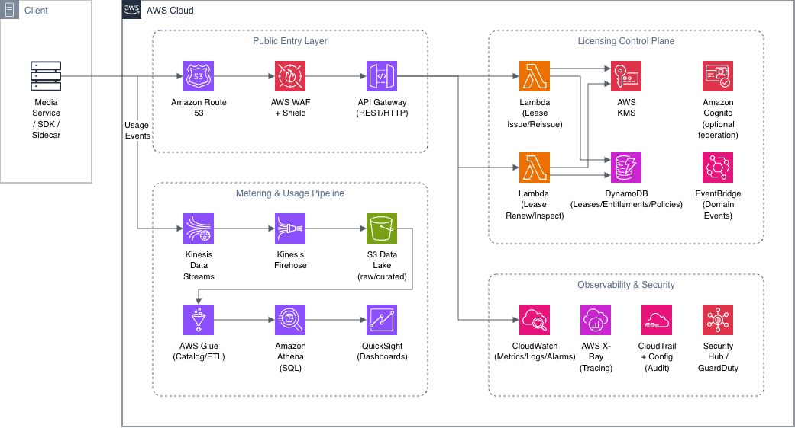
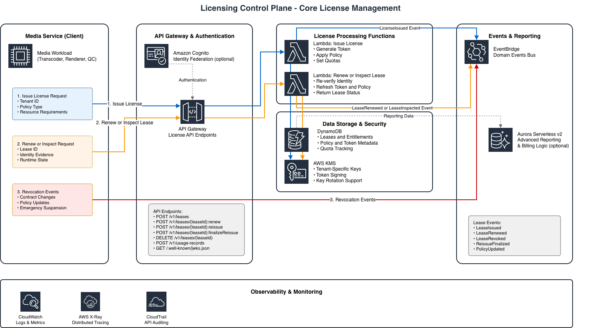
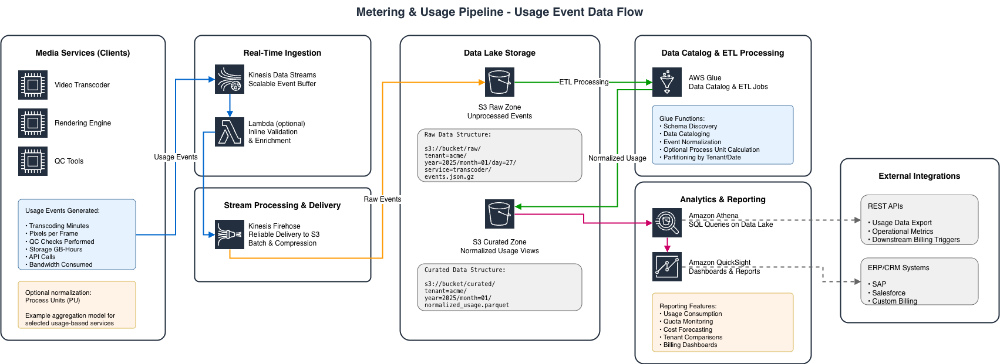

# Annex F. AWS Reference Architecture

## Purpose

This informative annex outlines one possible AWS-aligned realization of the platform-neutral
DSL reference model.

## Scope and Status

This annex is illustrative. It does not introduce normative requirements and it does not imply
that AWS-specific services are required for DSL alignment.

The architecture described here is AWS-first rather than multi-cloud. It is intended to show
how the DSL control-plane, metering, and trust concepts can be realized with established AWS
services and governance patterns.

## AWS-Specific Design Priorities

An AWS-oriented realization of DSL should preserve the same architectural priorities defined in
the main document while expressing them through AWS-native controls:

- API-first lifecycle handling through a single protected entry layer.
- Serverless-first control-plane behavior instead of static license servers.
- Security by design using least privilege, tenant-aware isolation, and managed key services.
- Observability through logs, metrics, traces, and auditable configuration state.
- Licensing as code through declarative policy and infrastructure delivery.

## Reference Architecture Zones

The AWS realization can be understood as five cooperating zones.

The current review material is also supported by a small set of local AWS diagrams that fit
this annex particularly well because they visualize the same architecture at three different
levels of detail:

- a high-level end-to-end AWS architecture view,
- a control-plane-focused license-management view,
- a metering and usage-pipeline data-flow view.

These views are reflected in the structure of this annex so that the text and the diagrams can
be reconciled later without changing the architectural intent.

### 1. Clients and Media Services

Media workloads consume the licensing platform through SDKs, sidecars, or equivalent runtime
integration. Typical workloads include transcoders, graphics engines, quality-control tools,
and other media services that need issue, renew, reissue, validation, and usage reporting
behavior.

### 2. Public Entry Layer

The public entry layer fronts the licensing platform and provides routing, protection, and
authentication entry points.

Typical AWS services include:

- Amazon Route 53 for DNS entry.
- AWS WAF and AWS Shield for perimeter protection.
- Amazon API Gateway as the canonical API front door.
- Amazon Cognito or federated identity as an optional user and API authentication layer.

### 3. Licensing Control Plane

The control plane implements the core DSL lifecycle and trust behavior.

Typical AWS realizations include:

- AWS Lambda or container-based services for issue, renew, reissue, revoke, and inspection
 logic.
- Amazon DynamoDB for lease, entitlement, policy, quota, and token metadata.
- AWS KMS or CloudHSM-backed designs for signing and key-management duties.
- Amazon EventBridge for lifecycle, policy, and operational domain events.
- Amazon Aurora Serverless v2 where relational reporting or accounting views are needed.

### 4. Metering and Usage Pipeline

Where license modality depends on measured consumption, the metering pipeline captures raw
usage, normalizes it, and prepares it for operational and commercial interpretation.

Typical AWS services include:

- Amazon Kinesis Data Streams for usage ingestion.
- Kinesis Data Firehose for managed delivery.
- Amazon S3 as the raw and curated data lake.
- AWS Glue for cataloging and normalization.
- Amazon Athena and Amazon QuickSight for queries, dashboards, forecasts, and consumption
 reporting.

### 5. Observability and Security Services

The platform should make license behavior transparent and auditable while maintaining secure
defaults.

Typical AWS services include:

- Amazon CloudWatch for logs, metrics, and alarms.
- AWS X-Ray or OpenTelemetry-compatible tracing for end-to-end request visibility.
- AWS CloudTrail and AWS Config for audit and configuration traceability.
- AWS Security Hub, GuardDuty, Inspector, and Macie for broader security posture monitoring.

## Example Mapping

| DSL function | Example AWS realization |
| --- | --- |
| API gateway | Amazon API Gateway |
| Control-plane compute | AWS Lambda or container-based services |
| Lease and entitlement store | Amazon DynamoDB or Aurora |
| Key management | AWS KMS or CloudHSM-backed design |
| Event orchestration | Amazon EventBridge and Step Functions |
| Usage analytics landing zone | Amazon S3 with downstream analytics services |
| Workload identity evidence | EC2 instance identity, IAM role, or EKS service account federation |
| Observability | Amazon CloudWatch and OpenTelemetry-compatible tooling |

## AWS Account and Organization Structure

For multi-tenant or production-grade DSL deployments, the AWS account model is part of the
security architecture rather than an administrative afterthought.

Common patterns include:

- AWS Organizations for centralized governance and billing structure.
- separation of security, logging, shared services, and workload accounts.
- distinct production, staging, and development boundaries.
- central guardrails through Service Control Policies and account vending controls.
- consistent tagging for tenant, service, environment, and cost attribution.

This structure supports least privilege, audit isolation, and cleaner separation between
customer-facing runtime services and central platform operations.

## Identity and Access Interpretation

AWS identity controls should align with the DSL trust model rather than replace it.

Important patterns include:

- prefer IAM roles and federated identities over long-lived users or static credentials,
- propagate tenant or project context through claims, role attributes, or session tags,
- keep secrets in AWS Secrets Manager or Systems Manager Parameter Store,
- use private connectivity and scoped service-to-service permissions where required,
- keep signing and encryption key access tightly bounded.

## Example Interaction Pattern

An AWS-based implementation may follow this pattern:

1. A workload running on EC2, ECS, or EKS gathers AWS-native identity evidence.
2. A license agent calls the DSL issue or renew endpoint.
3. The control plane verifies identity evidence, entitlement, and quota.
4. The control plane signs a runtime token and returns policy and expiry data.
5. The workload validates the token locally and continues operation without a synchronous
 dependency on the control plane.

In metered scenarios, a parallel usage path may send normalized usage events through Kinesis or
an equivalent ingestion path into the reporting and analytics layer.

## Design Considerations

- IAM and workload identity should be preferred over instance-bound manual activation.
- Network design should preserve least privilege and tenant isolation.
- Short-lived tokens and JWKS distribution should be integrated with key rotation practices.
- Operational telemetry should make renewal, grace, reissue, and revoke behavior visible.
- Tenant isolation should be visible in both the data model and the AWS account or key
 management design.
- Billing and reporting components should remain downstream consumers of lifecycle and usage
 events rather than redefining the canonical licensing semantics.

## Relationship to the Main Document

- Chapter 07 defines the platform-neutral reference model.
- Chapter 10 defines the canonical API behavior.
- Chapter 12 defines the trust and control expectations that still apply on AWS.

## Annex Positioning

This annex gives reviewers a concrete cloud example while preserving the platform-neutral
intent of the main best-practices text.
