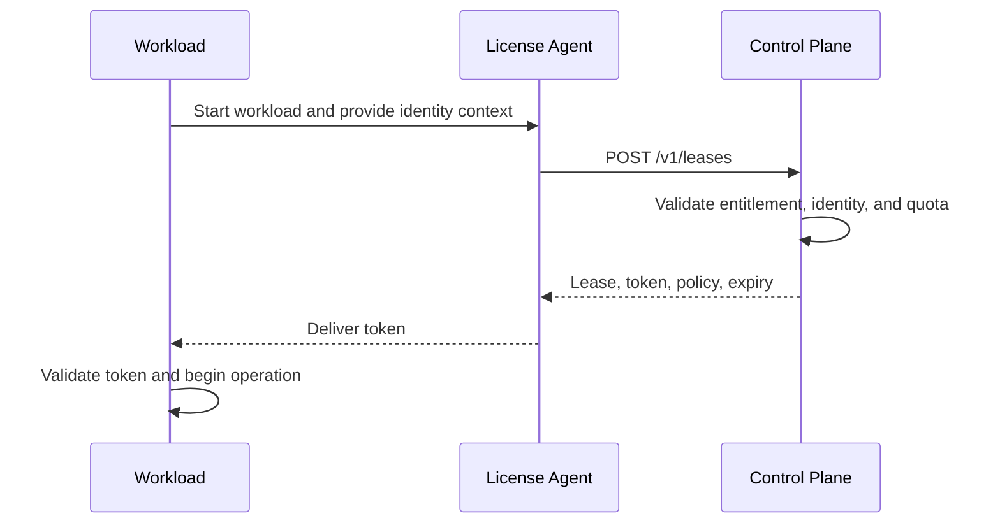
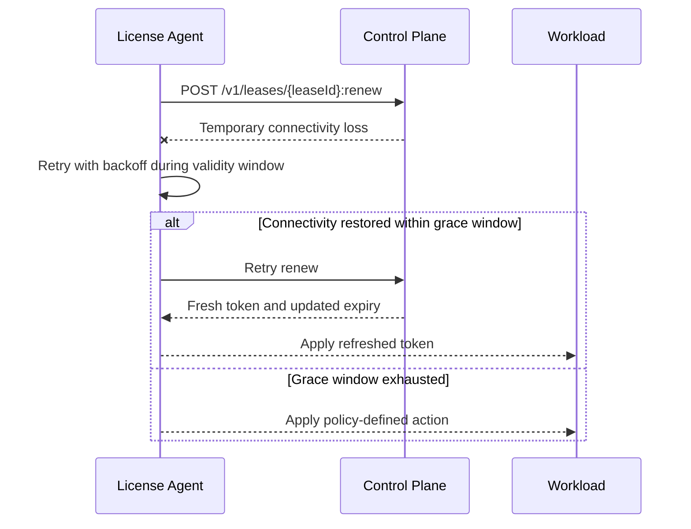
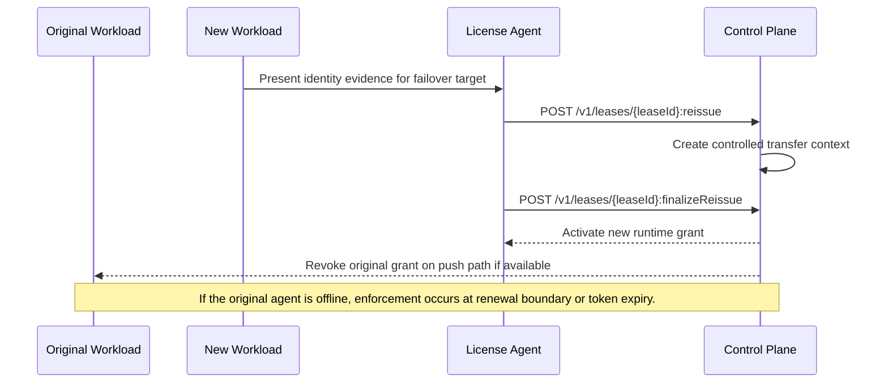

# Annex G. Example Sequences

## Purpose

This informative annex provides compact example sequences that illustrate how the canonical
lifecycle behaves in practice.

## Sequence 1. Initial Issue

1. The workload starts and the license agent collects identity evidence.
2. The agent calls the issue endpoint with `app`, `tenantId`, requested dimensions,
 `licenseModality`, identity evidence, and `workId`.
3. The control plane validates entitlement, identity, and quota.
4. The control plane creates a lease, signs a token, and returns policy and expiry data.
5. The application validates the token locally and begins operation.

## Sequence 2. Renewal with Temporary Connectivity Loss

1. The license agent opens the renewal window based on `renewBeforeSeconds`.
2. A renewal attempt fails because the control plane is temporarily unreachable.
3. The agent retries with backoff while the current token remains valid.
4. If connectivity returns within the grace window, renewal succeeds and a fresh token is
 applied.
5. If the grace window is exhausted, the workload applies the policy-defined action.

## Sequence 3. Reissue for Failover

1. A standby workload becomes the intended execution target.
2. The new workload presents identity evidence and calls the reissue operation.
3. The control plane creates a controlled transfer context.
4. Finalization completes the cutover and revokes the original runtime grant.
5. If the original agent is offline, revocation is enforced at the next renewal boundary or
 token expiry.

## Relationship to the Main Document

- Chapter 05 defines the workflow patterns that motivate these sequences.
- Chapter 10 defines the detailed API behavior.
- Annex D defines the baseline lifecycle states referenced by these examples.

## Annex Positioning

This annex provides simple walkthroughs intended to make the review draft easier to evaluate
without redefining the normative model.

The numbered prose sequences remain the primary informative walkthroughs in this annex. The
inline sequence diagrams complement them as visual summaries and do not supersede Annex D or
Chapter 10.
