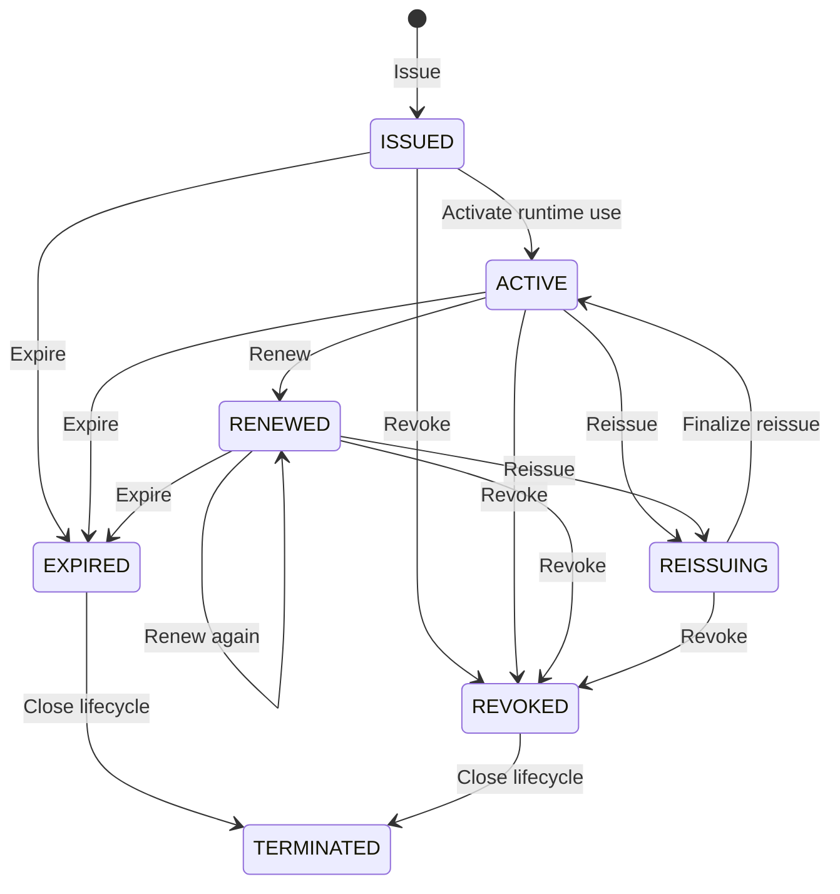

# Annex D. Lifecycle and State Model

## Purpose

This annex consolidates the baseline lease lifecycle states and the main operations that cause
state transitions in the DSL model.

## Canonical Lease States

| State | Meaning |
| --- | --- |
| `ISSUED` | A lease has been created and granted by the control plane |
| `ACTIVE` | A lease is currently valid for runtime use |
| `RENEWED` | A lease remains active after one or more successful renewals |
| `REISSUING` | A lease is in controlled transfer to a new identity or environment |
| `REVOKED` | A lease has been invalidated before natural expiry |
| `EXPIRED` | The validity window ended without further continuation |
| `TERMINATED` | The lease has reached a controlled end of use and is closed |

## Lifecycle Overview Diagram

## Primary Lifecycle Operations

| Operation | Typical transition intent |
| --- | --- |
| Issue | Create a new lease and enter `ISSUED` or `ACTIVE` |
| Renew | Continue an active lease and extend validity |
| Reissue | Move a lease into controlled transfer |
| Finalize reissue | Complete transfer and restore active runtime use |
| Revoke | End authorization before natural expiry |
| Expire | Reach the end of validity without successful continuation |
| Terminate | Close the lease after controlled completion of use |

## Transition Semantics

- `ISSUED` and `ACTIVE` may be collapsed internally by an implementation, but externally
 visible semantics should remain understandable.
- Renewal extends validity while preserving lease identity and policy semantics unless a policy
 update explicitly changes them.
- Reissue is the controlled mechanism for moving a grant between workload identities or
 environments.
- Revocation takes effect immediately where push is available and otherwise at the next renewal
 boundary or token expiry.
- Expiry and termination are distinct: expiry reflects elapsed validity, while termination is a
 deliberate lifecycle close.

## Operational Notes

- Grace behavior affects runtime continuity but does not replace lifecycle state semantics.
- Audit trails should preserve the sequence of issue, renew, reissue, revoke, expiry, and
 termination events.
- The state model should remain stable across profiles even where implementations differ
 internally.

## Annex Positioning

This annex is the compact normative reference for lifecycle-state interpretation in the published
DSL best practices.

The canonical form in this annex is the state and transition tables together with the semantic
notes above. The inline state diagram complements that normative baseline as a visual summary and
does not replace the tabular interpretation.
