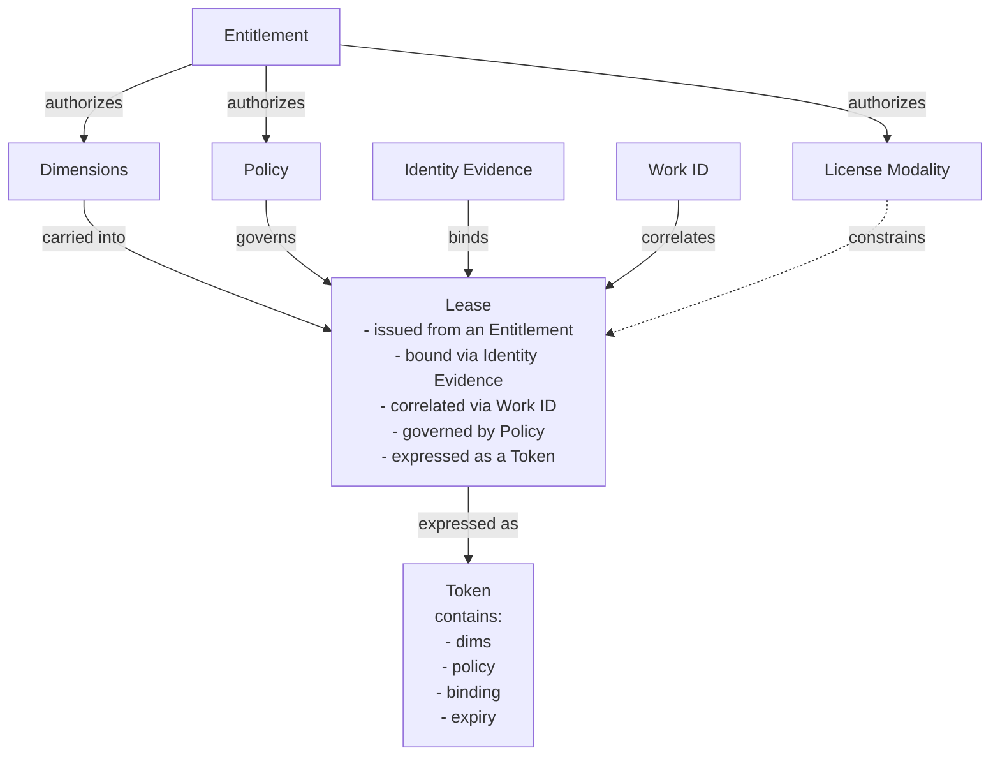

# 07.01 — Conceptual Model

## Purpose

This section defines the abstract concepts and their relationships within the Dynamic Software Licensing (DSL) model. It provides a platform-neutral view of how licensing is structured before any implementation detail is introduced.

## Core Concepts

The DSL model is built around the following foundational concepts:

### Entitlement

An entitlement represents the right granted to a user to use a specific application under defined conditions. It captures what the user has purchased or been allocated, including the dimensions (e.g., channels, FPS, bandwidth), the permitted license modality (e.g., hourly, daily, monthly, annual), and any associated policies.

An entitlement exists independently of any running workload. It is the source of truth for what a user is allowed to consume.

### Lease

A lease is a time-bound, active binding between an entitlement and a running workload. When a workload requests access to a licensed application, the system issues a lease that grants usage rights for a defined period.

A lease is derived from an entitlement through the following process: the license agent presents the workload's identity evidence and the requested application/dimensions to the control plane. The control plane looks up the tenant's entitlement for that application, verifies that the requested dimensions are within the entitlement's limits, confirms quota availability (i.e., not all lease slots are consumed), and — if all checks pass — creates a lease record and returns a signed token. The lease inherits its dimension limits and policy from the entitlement, scoped to a specific workload and bounded in time.

A lease is:
- derived from an entitlement (inheriting dimensions, license modality, and policy)
- bound to a specific workload identity
- expressed as a signed token that can be validated locally
- subject to renewal, reissue, and revocation

A lease may have one of three types:

1. Fixed-term up-front lease: licenses are paid for based on a start/end time or on the
  allowed runtime from initialization. When the time runs out, the application stops.
2. Credit-based or unit-consumption model: a pre-purchased pool of value is depleted based on
  actual usage metrics. When the pool runs out, the application stops.
3. Audit-based or post-paid model: elastic scaling is allowed, with periodic financial
  reconciliation based on peak or average usage. The application does not stop, but the
  customer is billed for actual usage.

### Token

A token is the portable, cryptographically signed artifact that represents a lease. It contains claims describing the user, application, dimensions, binding identity, expiry, and enforcement policy. Tokens are short-lived and validated locally by the application or SDK without requiring a round-trip to the control plane.

### Dimensions

Dimensions are the metered attributes that define what a user is entitled to use and how usage is measured. Examples include channel count, frames per second, bandwidth, concurrent users, or process units. Dimensions appear in entitlements, leases, and tokens.

### Identity Evidence

Identity evidence is the proof that a workload presents to establish its identity when requesting or renewing a lease. Examples include OpenID Connect workload tokens, SPIFFE/SVID identities, X.509 workload certificates, or platform-issued service account tokens. Identity evidence replaces traditional hardware-bound identifiers such as hostnames or MAC addresses.

### Policy

A policy defines the behavioral rules that govern a lease at runtime. It includes renewal timing, offline grace periods, actions to take when grace is exhausted (e.g., drain, degrade, stop), and alert thresholds. Policies are defined by the vendor, optionally overridden by the user (if permitted), and enforced locally by the license agent or SDK.

### Work ID

A work ID is a correlation identifier associated with a specific deployment or run. It supports idempotency, audit trails, and reissue operations. It is not a binding — it is a tracking reference.

## Concept Relationships

The relationships between these concepts follow a clear hierarchy:

## Lifecycle Summary

The conceptual lifecycle of a license interaction is:

1. A user holds an entitlement for an application with defined dimensions and license modality.
2. A workload starts and presents identity evidence to request a lease.
3. The control plane validates the entitlement, verifies identity, and issues a signed token.
4. The workload validates the token locally and operates within the granted dimensions.
5. The license agent renews the lease before expiry.
6. If the workload fails over, a reissue transfers the lease to a new workload identity.
7. When usage ends or policy dictates, the lease is revoked.

## Interaction Model

The DSL model assumes an interaction pattern where:

- The control plane is the authority for entitlements, lease issuance, policy, and centralized monitoring and observability.
- The workspace plane is where applications run and where tokens are validated locally.
- Communication between planes happens via well-defined API calls (REST) for all transactional operations.
- A push channel (WebSocket) MAY be used for real-time revocation and policy update delivery. The push channel is a complement to the REST API, not a requirement. If the push channel is unavailable or not implemented, revocation and policy changes take effect at the next renewal cycle (bounded by token TTL). Implementations that cannot support persistent connections remain fully functional.
- The license agent acts as the intermediary between the application and the control plane, handling all licensing operations transparently.

## Platform Neutrality

This conceptual model is intentionally abstract. It does not prescribe specific cloud services, runtime environments, or implementation technologies. The concepts described here should apply equally to cloud, hybrid, and on-premises deployments.

Implementation-specific mappings (e.g., AWS Lambda, DynamoDB, KMS) are reserved for annexes and implementation guides.
