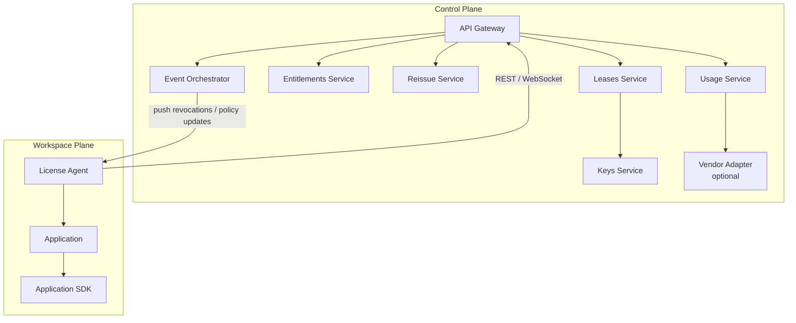

# 07.02. Functional Components

## Purpose

This section identifies the core services and functional building blocks that appear across implementations of the Dynamic Software Licensing model. Each component is described in terms of its responsibility, inputs, outputs, and relationship to other components.

## Component Overview

The DSL model is composed of the following functional components:

| Component | Plane | Primary Responsibility |
| --- | --- | --- |
| Leases Service | Control | Issue, renew, reissue, and revoke leases |
| Entitlements Service | Control | Manage tenant entitlements, quotas, and policy |
| Keys / JWKS Service | Control | Manage signing keys and publish public keys |
| Usage Service | Control | Record and store usage events |
| Reissue Service | Control | Coordinate lease transfer during failover |
| Event Orchestrator | Control | Timer-driven events for expiry, alerts, and moves |
| API Gateway | Control | Entry point for all REST and WebSocket traffic |
| License Agent | Workspace | Mediate between application and control plane |
| Application SDK | Workspace | In-process token validation |
| End User Portal | Cross-cutting | Aggregated license visibility and self-service |
| Vendor Adapter | Control (optional) | Mirror usage to ISV back-office or marketplace |

## Component Descriptions

### Leases Service

The leases service is the central transactional component of the control plane. It handles:

- Lease issuance: validates entitlements, verifies identity evidence, signs tokens via the keys service, and persists the lease record.
- Lease renewal: extends the TTL of an active lease and returns a fresh token.
- Lease revocation: marks a lease as revoked and triggers push notification to the affected license agent.

The leases service enforces least-privilege access and writes to an append-only audit log for every operation.

### Entitlements Service

The entitlements service manages the source-of-truth records for what each tenant is permitted to use. It provides:

- Entitlement lookup by tenant, application, and dimensions.
- Quota enforcement to prevent over-issuance.
- Policy defaults per product or SKU, including grace policies and license modality constraints.

Entitlements are typically provisioned through onboarding or procurement workflows and are read by the leases service during issuance.

### Keys / JWKS Service

The keys service manages the cryptographic signing keys used to produce lease tokens. It:

- Interfaces with a key management system (e.g., HSM or managed key service) to sign tokens.
- Publishes the corresponding public keys at a well-known JWKS endpoint (`/.well-known/jwks.json`).
- Supports key rotation via key identifiers (`kid` in token headers).

Applications and SDKs use the JWKS endpoint to validate tokens locally without contacting the leases service.

### Usage Service

The usage service records metered usage events submitted by license agents or SDKs. It:

- Accepts usage records with dimensions, quantities, timestamps, and correlation identifiers.
- Stores records in a hot store for operational queries and a cold store for analytics and billing.
- Supports idempotent submission to handle retries after network interruptions.

In a multi-vendor environment, usage data MUST be logically separated per ISV. Each vendor receives only the usage data associated with their own products. This prevents ISVs from accessing competitor usage data that may be collected within the same control plane deployment.

Usage data follows a metering model compatible with marketplace-style billing.

### Reissue Service

The reissue service coordinates the transfer of a lease from one workload to another, typically during failover or blue/green deployments. It:

- Creates a shadow lease for the target workload.
- Issues a cutover token to authorize the finalization.
- On finalization, revokes the original lease and activates the new one.
- Pushes a revocation event to the original license agent.

This two-phase approach (shadow + finalize) ensures atomic transfer without downtime.

### Event Orchestrator

The event orchestrator handles time-driven and event-driven operations. It:

- Triggers lease expiry processing.
- Sends renewal reminders and alert notifications.
- Manages move/reissue deadlines.
- Fans out events to notification channels (e.g., operations teams, monitoring systems).

### API Gateway

The API gateway is the unified entry point for all external communication with the control plane. It:

- Exposes REST endpoints for lease operations (`POST /v1/leases`, `POST /v1/leases/{leaseId}:renew`, `POST /v1/leases/{leaseId}:reissue`, `POST /v1/leases/{leaseId}:finalizeReissue`, `DELETE /v1/leases/{leaseId}`, `POST /v1/usage-records`).
- Exposes a WebSocket endpoint for push-based revocation and policy updates.
- Enforces authentication (IAM, OIDC, or custom), throttling, and perimeter security.
- Routes requests to the appropriate backend service.

### License Agent

The license agent is a sidecar, daemon, or CLI process that runs alongside the application in the workspace plane. It:

- Gathers identity evidence from the runtime environment.
- Calls the control plane API to issue, renew, and revoke leases.
- Delivers the signed token to the application (via file, socket, or environment variable).
- Maintains a WebSocket connection for receiving revocation and policy update events.
- Buffers usage events locally and uploads them when connectivity is available.
- Handles renewal scheduling, backoff, and grace policy enforcement.

The license agent abstracts all licensing complexity from the application.

### Application SDK

The application SDK is an in-process library that the application uses to:

- Validate the lease token locally using cached JWKS public keys.
- Expose granted dimension claims (e.g., channel count, FPS limit) to the application.
- React to token expiry and grace policy actions.

The SDK's role is to validate the token and make the granted entitlement data available to the application. Dimension enforcement — deciding whether to reject an operation that exceeds the licensed limits — is the responsibility of the application logic, not the SDK. This separation exists because dimension enforcement is highly application-specific, carries high liability, and cannot be generalized across different media functions. For example, the SDK exposes that the lease grants 4 channels; the application decides what happens when a 5th channel is requested.

The SDK is vendor-agnostic and open source.

### End User Portal

The end user portal provides a customer-facing interface for license management. It is described in detail in subchapter 07.05.

### Vendor Adapter (Optional)

The vendor adapter is an optional component that mirrors usage and lease events to an ISV's back-office system or a marketplace billing service. It enables vendors to reconcile usage data with their own billing and CRM systems.

## Component Interaction Summary

Workspace-side responsibilities shown in the model:

- identity evidence collection,
- token delivery,
- renewal scheduling,
- usage buffering,
- local token validation,
- dimension data exposure.
