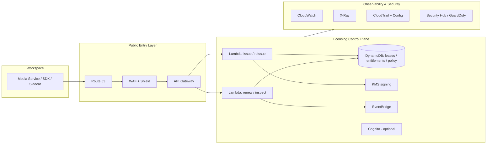
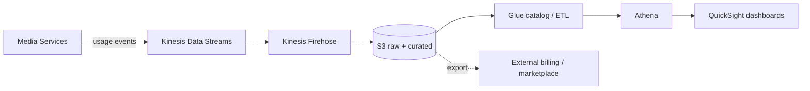

# AWS Reference Architecture (Annex F, informative)

GitHub-renderable version of the AWS-specific realization (Annex F Figs 2–4). Informative
only — AWS services are one possible realization of the platform-neutral model; they are
not required for DSL alignment.

## High-level architecture (Annex F, Fig. 2)

## Metering & usage pipeline (Annex F, Fig. 4)

