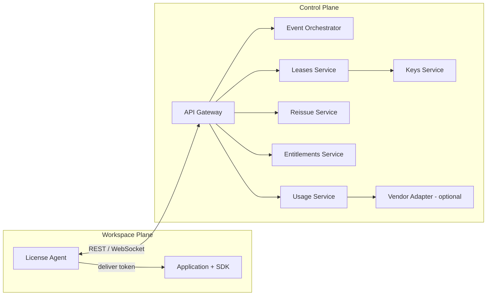

# Component Interaction (Ch.07.02)

Workspace-side responsibilities (identity collection, token delivery, renewal scheduling,
usage buffering, local validation, dimension exposure) interacting with the control-plane
services through the API gateway, with an optional vendor adapter for back-office/marketplace
mirroring.

