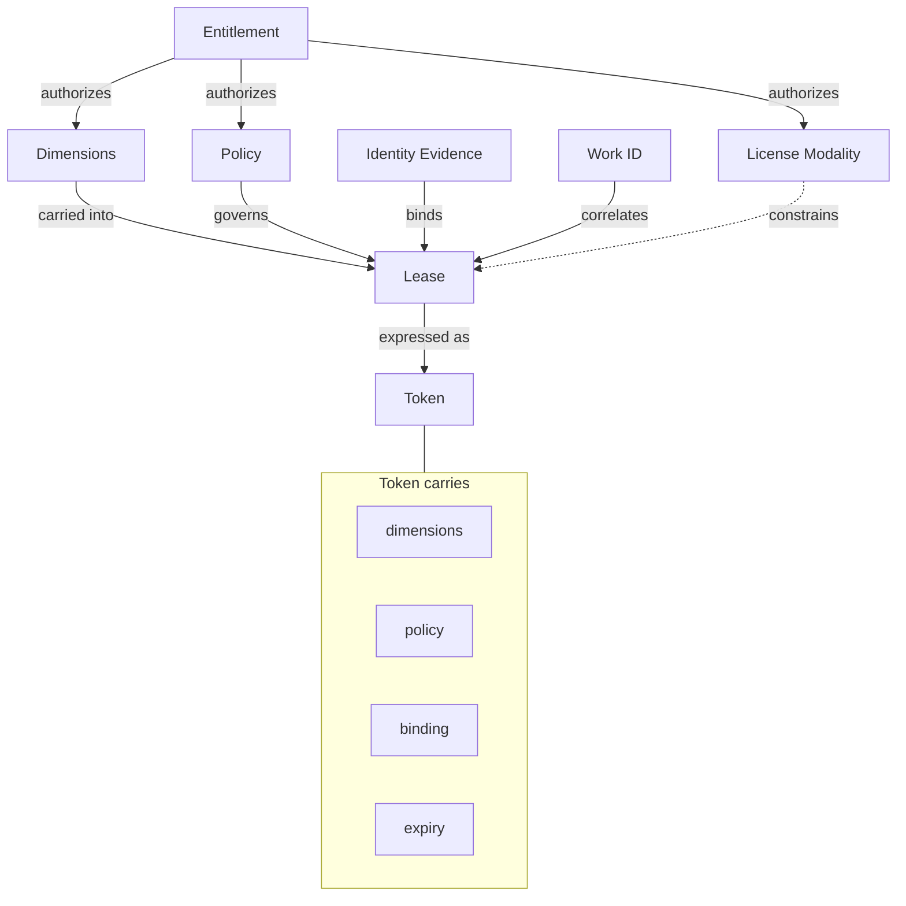

# Concept Relationships (Ch.07.01)

Entitlement authorizes dimensions, policy, and modality; a Lease is derived from an
entitlement, bound via identity evidence, correlated via work ID, governed by policy, and
expressed as a signed Token.

