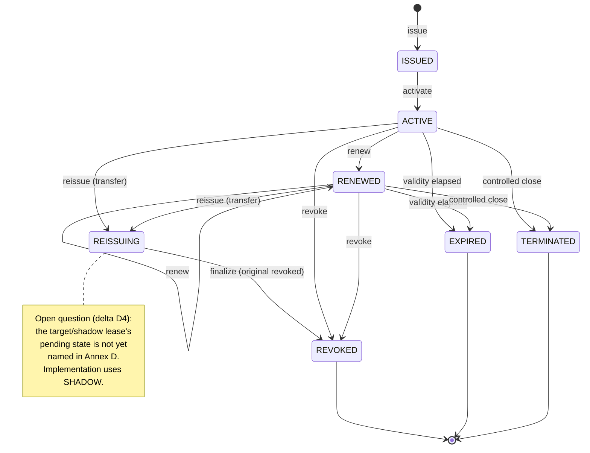

# Lease Lifecycle State Model (Annex D)

Canonical lease states per Annex D. `ISSUED` may be collapsed into `ACTIVE` by an
implementation. The shadow/target-lease state during two-phase reissue is an open question
(delta D4) and is shown as a note, not imported from the implementation's `SHADOW`.

