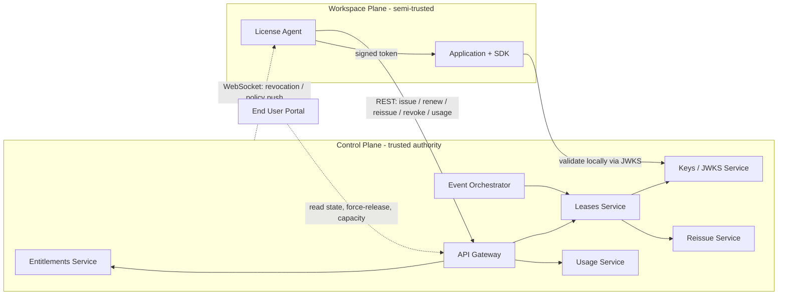

# Reference Model (Ch.07)

Platform-neutral view: the trusted Control Plane is the authority for entitlements, leases,
keys, policy, and usage intake; the semi-trusted Workspace Plane runs applications and
enforces locally using signed tokens. The End User Portal is a cross-cutting management
layer.

