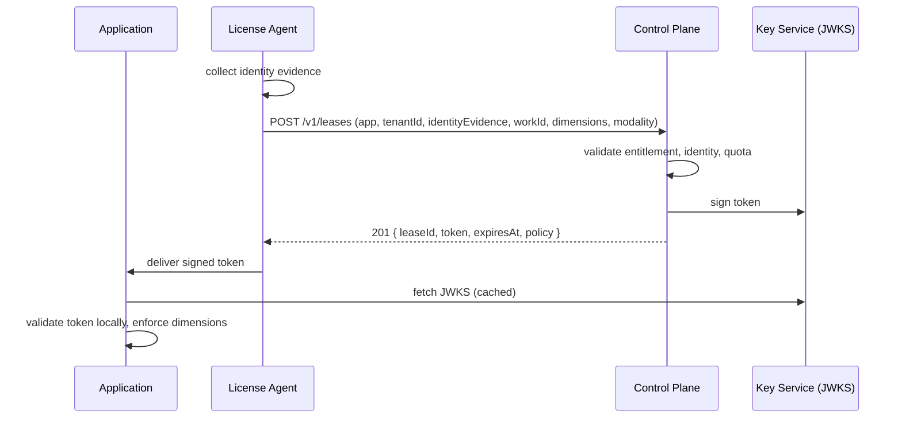
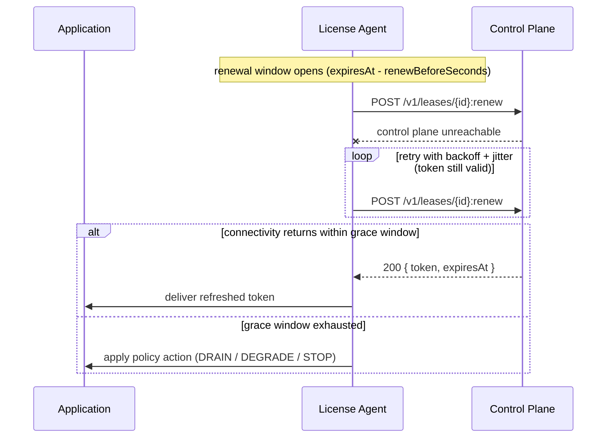
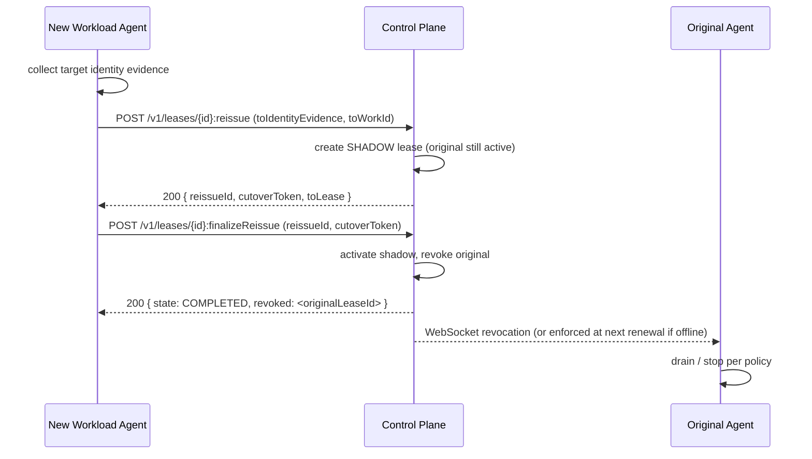

# Example Sequences (Annex G)

GitHub-renderable versions of the three Annex G sequences, which are currently prose-only.

## Sequence 1 — Initial Issue

## Sequence 2 — Renewal with temporary connectivity loss

## Sequence 3 — Reissue for failover (two-phase)

